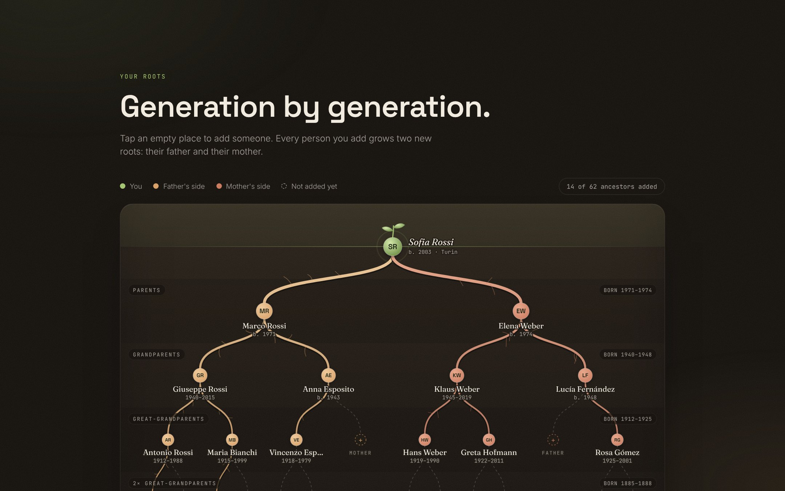
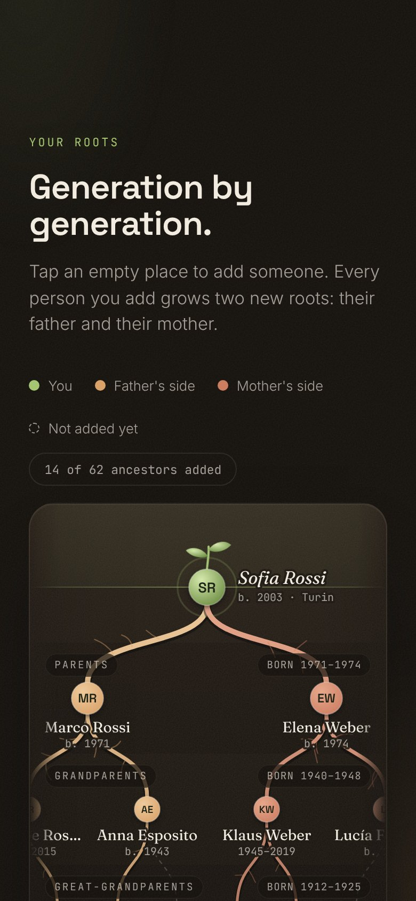

# ROOTS.

**Where do you come from?**

**Live:** [abejit-singh.github.io/roots](https://abejit-singh.github.io/roots/)

ROOTS is a single-page, interactive family tree that grows downwards, like roots: you at the surface, and every generation of your family a layer deeper. Add the people you know, and see how far back your family goes, where it was born, how its lives overlapped with yours, and how many people it took to make you.

No backend, no framework, no build step. Everything runs in the browser and is saved in its `localStorage`.

<p>
  
  
</p>

## Features

- **Your root system.** Your family drawn as roots under the ground, five generations deep: parents, grandparents, great-grandparents and two more, 62 ancestors in all. Every person you add grows two new roots, their father and their mother, so the tree grows one generation at a time. Hover (or focus) anyone to light up the line that connects them to you.
- **Everyone's details.** Name, year of birth and of death (or still living), town and country of birth, and a short story, edited in a side panel (a bottom sheet on phones). The years are checked, so a parent can never be born after their child.
- **The generations behind you.** How many ancestors you've added in each generation, how far back your known family history goes, and your family's own average age gap between parents and children.
- **Origins.** Where your family was born, generation by generation, and the towns it comes from. Country names typed in Italian ("Italia", "Germania"…) are recognised too.
- **The numbers behind you.** A slider through up to 40 generations: how many ancestors there are in each, roughly when they were born, and why the number can't keep doubling forever.
- **Their lifetimes.** Every life in the tree on one timeline, next to yours, with how many of them overlapped with your own.
- **Who should I ask about?** A closing screen that suggests whose name, or whose story, to ask your family about next.
- **Save a copy.** Download your tree as a file, and load it again later or on another device.

All numbers are computed live from what you enter. Nothing is hardcoded or simulated.

## How the numbers are calculated

| Figure                    | Formula                                                                                                                                                                                                                                                       |
| ------------------------- | ------------------------------------------------------------------------------------------------------------------------------------------------------------------------------------------------------------------------------------------------------------- |
| Places in each generation | 2ⁿ ancestors n generations back: 2 parents, 4 grandparents, 8 great-grandparents…                                                                                                                                                                             |
| People in total           | 2ⁿ⁺¹ − 2 between you and generation n                                                                                                                                                                                                                         |
| Places in the tree        | each person has a number: you are 1, and anyone's father is 2 × their number and their mother 2 × their number + 1 (the Ahnentafel numbering genealogists use). A number alone tells a person's generation, side of the family and exact relationship to you. |
| Years per generation      | the average gap between a parent's year of birth and their child's, over every pair where both are known; 28 years when there are none (a common estimate). It can also be set with a slider.                                                                 |
| Born around               | your year of birth − generations back × years per generation                                                                                                                                                                                                  |
| Family history            | this year − the earliest year of birth in your tree                                                                                                                                                                                                           |
| Overlapping lives         | ancestors still living, or who died in or after your year of birth                                                                                                                                                                                            |

## Running it locally

You need [Node.js](https://nodejs.org) 22 or later.

```sh
npm install
npm start
```

Then open <http://127.0.0.1:5173>.

The page is made of ES modules, which browsers only load from a server: opening `index.html` with a double-click shows an empty page. `npm start` runs a small static server; any other one works too.

## Scripts

| Command             | What it does                                              |
| ------------------- | --------------------------------------------------------- |
| `npm start`         | Serves the site at `http://127.0.0.1:5173`                |
| `npm run lint`      | ESLint, Stylelint and a Prettier formatting check         |
| `npm run format`    | Formats every file with Prettier                          |
| `npm run test:unit` | Unit tests of the calculations and the saved data         |
| `npm run test:e2e`  | The page in a real browser, at a desktop and a phone size |
| `npm test`          | Both kinds of test                                        |

The browser tests use [Playwright](https://playwright.dev), which needs its browser once: `npx playwright install chromium`.

## Project structure

```
index.html            the page: the markup of every section
css/
  fonts.css           the typefaces the site serves itself
  style.css           every style, by section, with a contents list at the top
js/
  main.js             entry point: starts the app
  config.js           constants, limits, generation names, the list of countries
  utils.js            small helpers: text, numbers, countries and flags
  slots.js            the numbering of the places in the tree
  state.js            the saved data: loading, checking, saving
  family.js           questions about the family: who is known, how far back
  effects.js          motion: counting numbers, sliders, pointer effects
  tree.js             the tree, drawn in SVG as roots
  generations.js      figures and one row per generation
  origins.js          where the family was born
  numbers.js          ancestors doubling at every generation
  lifelines.js        every life on one timeline
  finale.js           the closing screen and "Who should I ask about?"
  panel.js            adding, editing and removing a person
  flow.js             from the setup form to the tree; saving and loading a copy
  events.js           every event listener
fonts/                the typefaces (woff2) and their licences
icons/                the app icons
images/               the preview shown when the link is shared
docs/                 the screenshots on this page
tests/
  unit/               the calculations and the saved data, run in Node
  e2e/                the page in a real browser (Playwright)
manifest.json         app name, colours and icons for installation
service-worker.js     offline support
```

## How it is built

- **No framework and no build step.** Plain HTML, CSS and JavaScript. The files in this repository are the files the browser runs, and GitHub Pages serves the `main` branch as it is.
- **ES modules.** One module for each part of the page, loaded by the browser from `js/main.js`. The foundation (`config.js` → `utils.js` → `state.js`) imports nothing from the modules built on top of it.
- **One state object.** Everything the user enters lives in one object, saved to `localStorage` after every change. When it is read back every field is checked, so damaged or hand-edited data cannot break the page.
- **Rendering.** Each section has a function that rebuilds its markup from the state. Text typed by the user is escaped before it is inserted.
- **A number for every place in the tree.** You are 1; anyone's father is 2 × their number and their mother 2 × their number + 1 (the Ahnentafel numbering genealogists use). Generation, side of the family and relationship are all read from that number (`js/slots.js`), so the tree needs no links between people.
- **The tree is an SVG redrawn from the data.** `js/tree.js` rebuilds it on every change. The small hand-drawn details come from a seeded random generator, so the roots look the same on every visit.
- **A copy you can keep.** The tree can be saved as a JSON file and loaded back; a loaded file goes through the same checks as the saved data.
- **Nothing comes from another site.** The typefaces (Inter, Space Grotesk, Fraunces and JetBrains Mono) are served from this repository, and a Content Security Policy (`default-src 'self'`) makes the browser refuse anything else.
- **Offline.** A service worker keeps a copy of the app. Online, the page is always fetched fresh, so an update shows immediately; the copy is only used when there is no connection.
- **Motion is optional.** Animations are switched off for people who ask their system for reduced motion.

## Quality

- **Tests.** Unit tests for the calculations and for the data read back from storage; browser tests that use the page the way a visitor does, including reopening it with no connection and checking that it calls no other site.
- **Accessibility.** Labelled controls, keyboard access and text contrast that meets WCAG AA, checked with axe on the empty page and with data. One known exception: axe's "label in name" rule flags the people in the tree, whose visible text (initials, a shortened name) is shorter than their accessible name (full name, relationship, years).
- **Lighthouse** (phone profile, on a local copy served the way GitHub Pages serves it, November 2026): Performance 98 · Accessibility 100 · Best Practices 100 · SEO 100.

## Installing as an app (PWA)

ROOTS is a Progressive Web App: on the live site you can install it like a native app, with an "R." monogram matching the site's wordmark, and it keeps working offline.

- **On mobile:** open the site, then use your browser's "Add to Home Screen" option (Safari: Share → Add to Home Screen; Chrome: menu → Install app).
- **On desktop:** Chrome and Edge show an install icon in the address bar.

## Privacy

ROOTS collects nothing and sends nothing anywhere. There is no backend at all.

- **What's stored:** the people you add (names, years, places and stories) and the years-per-generation setting. They are saved only in your browser's `localStorage`, under the key `roots_state_v1`.
- **Where it goes:** nowhere. It never leaves your device. There's no analytics, tracking, cookies or logging of any kind. "Save a copy" downloads a file to your own device; nothing is uploaded.
- **Outside requests:** none. The page and its fonts come from this site, and the Content Security Policy blocks any other connection.
- **Security:** all text you enter is escaped before it is displayed, and saved data, and any file you load, is validated every time it is read.
- **Clearing your data:** use the reset button (bottom-left of the site) at any time.

A family tree holds information about other people too, some of them living. Keeping it on your own device, rather than on a server, is deliberate.

## Third-party files

Fonts: see [`fonts/README.md`](fonts/README.md) (SIL Open Font License).

## Disclaimer

ROOTS is a personal record of what you enter. It is not a genealogical database or a historical source, and it doesn't check anything against outside records. "Born around" dates and generation lengths are estimates. The chart follows the classic pedigree layout, with a father's and a mother's place for each person.

## Copyright

© 2026 Abejit. All rights reserved.

This project is shared publicly on GitHub for portfolio purposes. No license is granted to copy, modify, redistribute or reuse this code or design. Please don't recreate this project. If you'd like to use any part of it, get in touch first.
